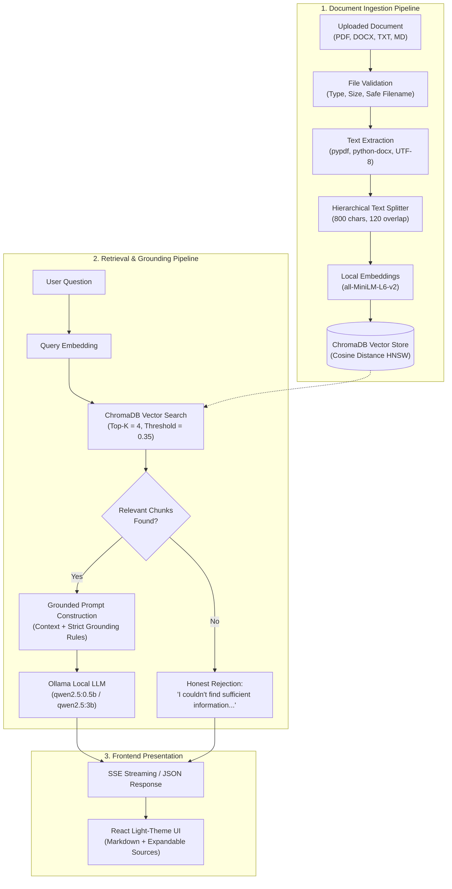

# DocuMind AI — Local Document-Based RAG Chatbot

[](https://www.python.org/)
[](https://fastapi.tiangolo.com/)
[](https://react.dev/)
[](https://www.typescriptlang.org/)
[](https://www.trychroma.com/)
[](https://ollama.ai/)
[](LICENSE)

**DocuMind AI** is a production-grade, local document question-answering system built using **Retrieval-Augmented Generation (RAG)**. It allows users to upload documents (PDF, DOCX, TXT, Markdown) and ask questions in natural language. Answers are strictly grounded in document context with verified citations and source references.

> **100% Local & Privacy-Preserving**: Operates without cloud LLM APIs, external data transmission, or paid subscriptions. All embeddings, vector storage, and language model inference run locally on your machine.

---

## Architecture Overview



---

## Key Features

- **Document Ingestion Pipeline**:
  - Support for `.pdf`, `.docx`, `.txt`, and `.md` formats.
  - Page-level attribution preserved for PDF documents.
  - Hierarchical character text chunking (default: 800 characters, 120 character overlap).
  - Validation: size limit (25 MB), MIME-type verification, and path traversal protection.
  - Background asynchronous processing with real-time status updates: `Uploaded` &rarr; `Extracting text` &rarr; `Creating embeddings` &rarr; `Indexing` &rarr; `Ready`.

- **Vector Storage & Semantic Retrieval**:
  - Persistent ChromaDB vector database with HNSW cosine distance indexing.
  - Local dense embeddings using `sentence-transformers/all-MiniLM-L6-v2` (384 dimensions, normalized).
  - Configurable `top_k` (default: 4) and cosine similarity threshold (default: 0.35).
  - Complete document deletion: removes raw files, ChromaDB vector chunks, and SQLite metadata.

- **Local LLM Inference**:
  - Seamless integration with **Ollama** (`qwen2.5:0.5b`, `qwen2.5:3b`, etc.).
  - Real-time Server-Sent Events (SSE) token streaming.
  - Strict grounding system prompt to eliminate hallucinations.
  - Honest fallback when context is insufficient:
    > *"I couldn't find sufficient information to answer this question from the uploaded documents."*

- **Professional Light-Theme SaaS Interface**:
  - Designed according to modern SaaS principles: pure white background, soft slate borders, indigo accents, and clear typography.
  - Collapsible sidebar with conversation history and document management.
  - Expandable source citation drawers displaying filename, page number, match percentage, and verbatim excerpts.
  - Suggested question cards and live system status indicator for local AI availability.

---

## Technology Stack

| Layer | Technology | Details |
|---|---|---|
| **Frontend** | React 19, TypeScript, Vite | Modern component architecture |
| **Styling** | Tailwind CSS v4, Lucide React | Clean, light-theme design system |
| **Backend** | Python 3.12, FastAPI, Pydantic v2 | High-performance asynchronous REST API |
| **Vector DB** | ChromaDB | Persistent vector storage with cosine indexing |
| **Embeddings** | SentenceTransformers (`all-MiniLM-L6-v2`) | Local 384-dimensional dense vectors |
| **Local LLM** | Ollama | Local inference (`qwen2.5:0.5b`, `qwen2.5:3b`) |
| **Database** | SQLite 3 | Chat history and document metadata |
| **Parsers** | PyPDF, python-docx | Text and page extraction |

---

## Project Structure

```
Chatbot1/
├── backend/
│   ├── app/
│   │   ├── api/
│   │   │   ├── routes/
│   │   │   │   ├── health.py          # GET /api/health
│   │   │   │   ├── documents.py       # Upload, list, delete documents
│   │   │   │   ├── chat.py            # Non-streaming & SSE streaming Q&A
│   │   │   │   ├── conversations.py   # Chat sessions and history
│   │   │   │   └── settings.py        # Runtime RAG tuning
│   │   │   └── dependencies.py        # Service singletons
│   │   ├── core/
│   │   │   ├── config.py              # Settings via pydantic-settings
│   │   │   ├── logging.py             # Structured logger
│   │   │   └── exceptions.py          # Safe domain exceptions
│   │   ├── models/
│   │   │   └── database.py            # SQLite schema and connections
│   │   ├── schemas/                   # Pydantic request/response models
│   │   ├── services/
│   │   │   ├── ingestion_service.py   # Extraction, chunking, indexing
│   │   │   ├── embedding_service.py   # SentenceTransformers manager
│   │   │   ├── retrieval_service.py   # ChromaDB client & vector search
│   │   │   ├── ollama_service.py      # Ollama REST client & streaming
│   │   │   ├── rag_service.py         # Grounding & prompt composition
│   │   │   ├── document_service.py    # Document lifecycle
│   │   │   └── conversation_service.py# SQLite conversation history
│   │   ├── utils/
│   │   │   ├── file_utils.py          # PDF/DOCX/TXT parsers, sanitizer
│   │   │   └── text_splitter.py       # Recursive character splitter
│   │   └── main.py                    # FastAPI entrypoint
│   ├── tests/                         # Pytest automated test suite
│   ├── requirements.txt               # Backend dependencies
│   └── .env.example
├── frontend/
│   ├── src/
│   │   ├── components/
│   │   │   ├── chat/                  # ChatArea, MessageList, Input, Sources
│   │   │   ├── documents/             # Dropzone, DocumentList, Modal
│   │   │   ├── layout/                # Sidebar, Header
│   │   │   ├── common/                # Button, Modal, Badge, StatusIndicator
│   │   │   └── settings/              # SettingsModal
│   │   ├── hooks/                     # useChat, useDocuments, useHealth
│   │   ├── services/                  # api.ts (REST & SSE fetch client)
│   │   ├── types/                     # TypeScript interfaces
│   │   ├── App.tsx                    # Main application component
│   │   └── index.css                  # Tailwind CSS styling
│   ├── package.json
│   └── vite.config.ts
├── data/
│   ├── uploads/                       # Persisted uploaded documents
│   ├── chroma/                        # Persisted ChromaDB vectors
│   ├── application/                   # SQLite database (documind.db)
│   └── sample_documents/              # Test files included for demo
├── scripts/
│   ├── start_all.bat                  # One-click launcher (Windows)
│   ├── start_backend.bat              # Backend launcher
│   ├── start_frontend.bat             # Frontend launcher
│   ├── run_tests.bat                  # Automated test runner
│   └── verify_rag_pipeline.py         # Live pipeline validation script
├── .gitignore
├── .env.example
└── README.md
```

---

## Prerequisites

Before starting, ensure the following software is installed on your Windows machine:

1. **Python 3.12** (or 3.10+):
   - Download from [python.org](https://www.python.org/).
   - Ensure you check **"Add Python to PATH"** during installation.

2. **Node.js 20+ & npm**:
   - Download from [nodejs.org](https://nodejs.org/).

3. **Ollama**:
   - Download from [ollama.ai/download](https://ollama.ai/download).
   - Once installed, make sure the Ollama service is running.

---

## Quick Start Guide

### Step 1: Download a Local LLM Model

Open a terminal or PowerShell prompt and run:
```powershell
ollama pull qwen2.5:0.5b
```
*(Optional: For higher reasoning capacity on machines with 8GB+ RAM, run `ollama pull qwen2.5:3b`)*.

Verify Ollama is running and responding:
```powershell
curl http://localhost:11434/api/tags
```

---

### Step 2: One-Click Launch (Windows)

Simply double-click:
```
scripts\start_all.bat
```
This script opens both the FastAPI backend (`http://127.0.0.1:8000`) and the Vite React frontend (`http://localhost:5173`) in separate windows.

---

### Manual Launch Instructions

#### Backend Setup & Run

1. Open a PowerShell window in the project root:
   ```powershell
   cd c:\Users\sanma\OneDrive\Desktop\Chatbot1\backend
   ```
2. Activate the virtual environment:
   ```powershell
   .\venv\Scripts\Activate.ps1
   ```
3. Install dependencies (if not already installed):
   ```powershell
   pip install -r requirements.txt
   ```
4. Start the FastAPI server:
   ```powershell
   uvicorn app.main:app --host 127.0.0.1 --port 8000 --reload
   ```
   API interactive documentation is available at [http://127.0.0.1:8000/docs](http://127.0.0.1:8000/docs).

#### Frontend Setup & Run

1. Open another terminal in the `frontend` folder:
   ```powershell
   cd c:\Users\sanma\OneDrive\Desktop\Chatbot1\frontend
   ```
2. Install packages (if not already installed):
   ```powershell
   npm install
   ```
3. Start the development server:
   ```powershell
   npm run dev
   ```
4. Open your browser and navigate to:
   ```
   http://localhost:5173
   ```

---

## How to Test the Application

### 1. Automated Backend Test Suite
Run the full test suite (17 unit and integration tests covering extraction, chunking, retrieval, honest responses, and error handling):
```powershell
.\backend\venv\Scripts\pytest -v backend\tests
```
*All tests use isolated temporary environments and mocks for offline execution.*

### 2. Live End-to-End Pipeline Verification
To verify the complete live pipeline (live Ollama inference + live ChromaDB + live embeddings):
```powershell
.\backend\venv\Scripts\python.exe scripts\verify_rag_pipeline.py
```

### 3. Manual UI Verification Workflow
1. Open the application at `http://localhost:5173`.
2. Notice the green **"Local AI Online"** indicator in the top header.
3. Click **"Documents"** in the header or sidebar.
4. Drag and drop the included sample file:
   `data\sample_documents\internship_handbook.txt`
5. Watch the real-time processing indicator transition:
   `Uploaded` &rarr; `Extracting text` &rarr; `Creating embeddings` &rarr; `Indexing` &rarr; `Ready`.
6. Close the modal and ask in the chat:
   > *"What is the monthly stipend and working hours?"*
7. Observe the answer grounded directly in the document with the exact figure (45,000 INR, 9:30 AM to 5:30 PM IST).
8. Click **"View Sources"** below the response to inspect the exact excerpt and similarity score.
9. Now ask an out-of-scope question:
   > *"What is the capital of Mars?"*
10. Verify that the assistant responds with:
    > *"I couldn't find sufficient information to answer this question from the uploaded documents."*

---

## Configuration & Tuning

Configuration settings are stored in `.env` (or configured via the UI **Settings** modal):

| Variable | Default | Purpose |
|---|---|---|
| `OLLAMA_BASE_URL` | `http://localhost:11434` | Ollama daemon endpoint |
| `DEFAULT_LLM_MODEL` | `qwen2.5:0.5b` | Model used for document Q&A |
| `EMBEDDING_MODEL_NAME` | `sentence-transformers/all-MiniLM-L6-v2` | Embedding model |
| `CHUNK_SIZE` | `800` | Chunk size in characters |
| `CHUNK_OVERLAP` | `120` | Chunk overlap in characters |
| `TOP_K` | `4` | Number of chunks retrieved for context |
| `SIMILARITY_THRESHOLD` | `0.35` | Minimum cosine similarity to consider relevant |
| `MAX_UPLOAD_SIZE_MB` | `25` | Maximum upload file size limit |

---

## Troubleshooting

### 1. Ollama Offline or Status Red
- Check if Ollama is running in your Windows taskbar.
- Run `ollama serve` in a terminal.
- Ensure the port `11434` is not blocked by Windows Firewall.

### 2. Windows Defender SmartAppControl (WinError 4551)
If Windows Defender blocks native DLLs in OneDrive directories:
```powershell
Get-ChildItem -Path "backend\venv\Lib\site-packages" -Recurse -Filter "*.dll" | Unblock-File
```

### 3. Model Not Found Error
If the active model is not installed:
```powershell
ollama pull qwen2.5:0.5b
# or
ollama pull qwen2.5:3b
```
Open the in-app **Settings** modal and select your preferred installed model.

---

## Production Hardening Recommendations

Before deploying this internship project to a public multi-user environment:
1. **Authentication & Multi-Tenancy**: Add JWT authentication and tenant-scoped collection namespaces in ChromaDB.
2. **Rate Limiting**: Integrate `slowapi` to prevent API exhaustion.
3. **Sandboxed Parsers**: Run document text extraction in isolated worker processes.
4. **HTTPS / TLS**: Terminate TLS at a reverse proxy (e.g., Nginx or Caddy).

---

## License

DocuMind AI is open-source under the MIT License.
